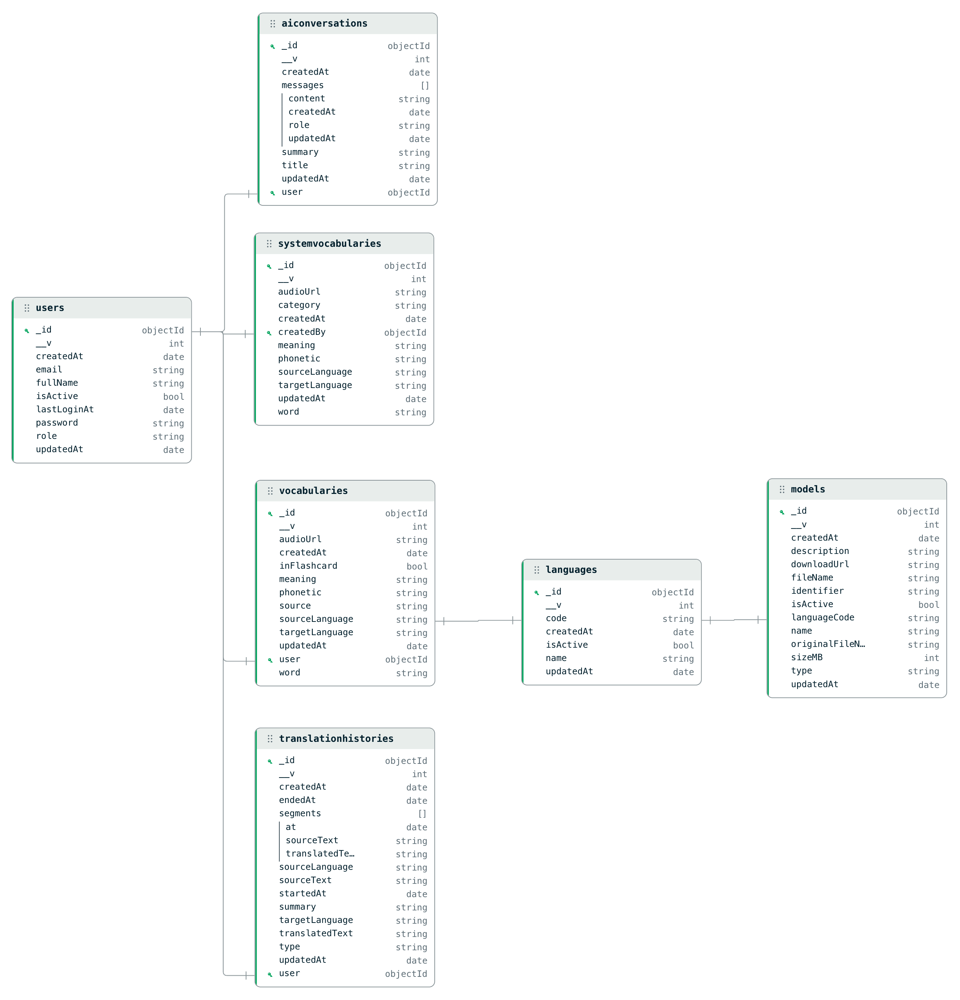

# lingua — AI Translation & Language Learning App

Course project for **Advanced Database Systems** (Master's program). A translation /
language-learning app used as a vehicle to study **NoSQL document modeling** on MongoDB:
embedding vs referencing, polymorphic documents, schema validation at the database layer,
query-driven indexing, and data integrity without foreign keys.

| Component | Stack | Notes |
|---|---|---|
| `mobile/` | Flutter 3.x (iOS + Android) | On-device translation (ML Kit), speech-to-text (Vosk, Android only), TTS |
| `backend/` | Node.js + Express + Mongoose | REST API on port **5001**, JWT auth, Gemini for AI chat |
| `admin-web/` | React | Admin dashboard: users, languages, models, system vocabulary, stats |
| Database | MongoDB 7 (Docker) | Database `language_app`, 7 collections |

## Database design



*Generated with MongoDB Compass (Data Modeling) from the live database. Solid edges are
`ObjectId` references; `languages` is referenced softly by code string (`"en"`, `"vi"`, …).*

### Collections

| Collection | Purpose | Key design decision |
|---|---|---|
| `users` | Accounts (user/admin) | bcrypt-hashed password, `select: false` |
| `translationhistories` | Translation history | **Polymorphic** by `type` (`text` \| `speech` \| `ai_chat` \| `conversation`); live-voice sessions embed a `segments[]` array |
| `vocabularies` | Per-user saved words | Compound unique index `{user, word, targetLanguage}` |
| `systemvocabularies` | Admin-curated word bank | `createdBy` → `users` |
| `aiconversations` | Gemini chat sessions | `messages[]` embedded — one read returns the whole conversation |
| `languages` | Supported languages | Soft-referenced **by `code`**, not ObjectId |
| `models` | Vosk / ML Kit model catalog | Unique `{type, languageCode, identifier}` |

### Design decisions worth defending

1. **Embed vs reference.** AI messages and voice-session segments are embedded in their
   parent document because they are always read/written together and never queried
   independently — one query returns the whole object, no joins. Vocabulary and history
   are separate collections because they need pagination and their own indexes.
   Embedded arrays are **bounded** (app caps a conversation at 200 messages, the DB
   validator hard-caps at 400) to stay clear of the 16 MB document limit.
2. **Soft references by language code.** History and vocabulary store `"en"` / `"vi"`
   strings instead of ObjectIds: documents are self-contained (no populate, offline-cache
   friendly). The trade-off — no referential integrity — is handled at the API layer:
   deleting a referenced language is rejected (HTTP 409) in favor of soft-delete
   (`isActive: false`).
3. **No `ON DELETE CASCADE` in MongoDB.** Deleting a user cascades over that user's
   vocabulary/history/conversations in application code — wrapped in a multi-document
   **transaction** when MongoDB runs as a replica set, with a sequential fallback on
   standalone (the API response reports `atomic: true/false`).
4. **Two-layer validation.** Mongoose validates in the app; `$jsonSchema` validators on
   all 7 collections make MongoDB itself reject invalid writes (even direct `mongosh`
   inserts), including the conditional shape of the polymorphic history documents
   (`oneOf` on `type`).
5. **Query-driven indexes.** Every list screen filters by user and sorts by time, so the
   indexes are compound (`{user: 1, createdAt: -1}`, `{user: 1, updatedAt: -1}`).
   Verified with `explain()`: the recents query examines **20 of 2,563** documents via
   `IXSCAN` with no in-memory sort stage.

## Offline-first mobile app and guest mode

The mobile app no longer needs the backend to be useful.

| Feature | Guest (no account) | Signed in, backend down | Notes |
|---|---|---|---|
| Text translation | yes | yes | ML Kit on device; language pack downloaded once |
| Speech to text | yes (Android) | yes (Android) | Vosk on device; model downloaded once |
| Text to speech | yes | yes | system engine |
| Translation history | yes, local only | yes, queued for sync | |
| Saved words / flashcards | yes, local only | yes, queued for sync | |
| System word bank | no (never downloaded) | cached copy | refreshed whenever online |
| AI chat / summaries | no | no | needs Gemini through the backend |
| Change password, admin features | no | no | need the backend |

How it works (`mobile/lib/core/`):

- `session.dart` – guest / account identity; local data is namespaced per user.
- `api_client.dart` + `backend_status.dart` – 8 s timeout, network errors become
  `NetworkException`, and a 20 s circuit breaker makes calls fail fast while offline.
  Guests never call protected endpoints.
- `local_store.dart` – SharedPreferences JSON store with a lock for atomic updates.
- `sync_queue.dart` – writes made offline are stored locally first, queued, and replayed
  in order when the backend is reachable (profile -> "Đồng bộ ngay", app start, login,
  logout, pull-to-refresh). Creates are idempotent (vocabulary is an upsert on the server).
  When a guest signs in, their local history and words are adopted by the account.
- `builtin_models.dart` – default language list and Vosk model links so a fresh install
  works with the backend unreachable.
- Model resolution (`model_service.dart`): installed on device -> backend (cached) ->
  built-in default. Once a Vosk model is installed the backend is never asked again for
  that language; ML Kit packs already on the device skip the backend too.
- `screens/models/offline_models_screen.dart` (Profile -> "Gói ngoại tuyến") lets the user
  pre-download or delete packs.

- `screens/translate/conversation_detail_screen.dart` – tapping a voice-session entry in
  "Gần đây" opens its turns with times, start / end / duration and an AI summary button
  (summary needs the backend; an existing summary is cached and readable offline).

After pulling these changes run `flutter pub get` (new dependency: `shared_preferences`).

## Getting started

```bash
# 1. MongoDB (Docker)
docker start it2011-mongo || docker run -d --name it2011-mongo -p 27017:27017 mongo:7

# 2. Backend (port 5001 — do NOT use 5000, macOS AirPlay owns it)
cd backend
npm install
npm run seed:admin      # admin@example.com / Admin@123
npm run seed:data       # base sample data + user1@example.com / User@123
npm run db:sync         # attach $jsonSchema validators + sync indexes (idempotent)
npm run seed:rich       # optional: 15 learners + ~2.5k histories for demos/benchmarks
node server.js

# 3. Mobile (iOS simulator — must be an x86_64/Rosetta device, see CLAUDE.md)
cd ../mobile
flutter build ios --debug --simulator
```

Copy `backend/.env.example` to `backend/.env`; leaving `GEMINI_API_KEY` empty is fine —
the AI chat tab returns a friendly error bubble until you provide a key.

### Test accounts (local seed only)

| Account | Password | Role |
|---|---|---|
| `admin@example.com` | `Admin@123` | admin |
| `user1@example.com` | `User@123` | user |
| `learner1..15@example.com` | `User@123` | user (only after `seed:rich`) |

## Backend scripts

| Script | What it does |
|---|---|
| `npm run seed:admin` | Create the admin account |
| `npm run seed:data` | Reset base sample data (languages, models, word bank, demo users) |
| `npm run db:sync` | Attach `$jsonSchema` validators to all 7 collections and `syncIndexes()` (drops stale indexes). Idempotent — safe to re-run |
| `npm run seed:rich` | Bulk data for demos: 15 learners, ~250 vocabulary entries, ~2,500 histories spread over 120 days, AI conversations. Deterministic seed — re-running replaces its own batch |

## Repository notes

- UI prototypes (clickable, single-file HTML, iOS + Android side by side) live in
  [`docs/prototype/`](docs/prototype/) — `prototype_v2.html` is the current design;
  open it directly in any browser, no build step.
- Engineering conventions and platform pitfalls (iOS simulator arch, Vosk guard,
  validator/index rules) are documented in [`CLAUDE.md`](CLAUDE.md).
- This is a **private** course-project repository — keep it private.
